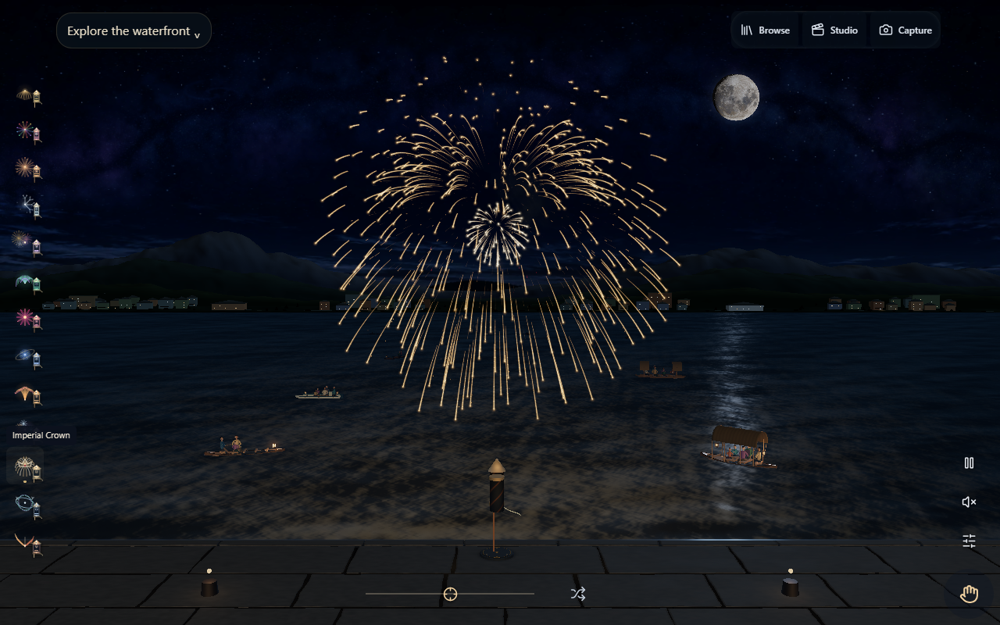

# Spark upstream — verified production release, 13 October 2026

The owner's condition to meet the timing target before production was satisfied. [PR #51](https://github.com/samir1234khans/firecrackers/pull/51) merged at `607ac370cc14d5a6904e365cb9e1335fbefb58c6`. That exact main commit's immutable Runtime artifact is deployed to [Firecrackers](https://firecrackers.mainandmany.com/), release `2026-10-12.1`. This receipt and accompanying status edits are documentation only; application bytes remain those of the verified deployment source.

| Release identity | Verified value |
|---|---|
| Deployed main source | `607ac370cc14d5a6904e365cb9e1335fbefb58c6` |
| Public fingerprint | `a809f42861e1d5c3fef9977ed25b478108cc480220e1ec87ad87eabe242bfd46` |
| Fingerprinted source/config/asset entries | 196 |
| Worker version | `04239f14-7971-4fd4-ab1a-894d2bbfe10e` |
| Retained rollback Worker | `e30d2169-d45f-4be4-bd9d-4f4efc468986` |

## Delivered

Ten moving boats, 33 anonymous passengers and four family views; natural shoreline, shared water/wakes/contacts and environment reactions; near/far placement, illustrated effects, glass controls and complete immersion; Lively Celebration, independently controlled effects/crowd/instrumental audio; generic particle lettering and keyboard/pointer light drawing, grouped schema-2 recipes with schema-1 rules; optional entrance with direct play remaining default. The thirteen canonical effects, Studio/saved shows, capture, four Always Play quantities, offline fallback and explicit updates remain. Spark is unchanged. The [donor manifest](donor-manifest.json) records the approved pin and later audit; no wedding facts, portraits, religious art, guest data or invitation conductor were imported.

## Qualification and promotion

The [performance resolution](performance-resolution/README.md) records the original 25 ms Standard WebGL Super High failure and the measured correction: scoped chrome variables avoid inherited invalidation across 2,321 DOM elements without dropping scene detail. Candidate Super High, idle and close-up browser-cadence p95 repeatedly measured 4.3 ms on the same PC; the proposed greater-of-2-ms-or-20% allowance passes for WebGL and WebGPU. Separate CPU submission is retained, including 6.9–7.3 ms confirming WebGL Super High p95. These are desktop browser/CPU measurements, not completed GPU duration. Two actual launch windows per GPU backend retain 4.3 ms p95 with no frames over 33 ms inside those windows; an isolated 37.4 ms interval outside a burst window remains in the raw report.

All 464 units, lint/typecheck/build/soak/audit and the required [PR Runtime](https://github.com/samir1234khans/firecrackers/actions/runs/38413462988) passed. The exact deployed main's [Runtime](https://github.com/samir1234khans/firecrackers/actions/runs/38416485506) passed **all 17 jobs**, and [main documentation](https://github.com/samir1234khans/firecrackers/actions/runs/38416485419) passed before deployment. [PR](production/pr-ci.json) and [main](production/main-ci.json) snapshots retain source and outcomes. Separate cinematic, richer-night, full-night and capture regressions passed on the qualified PR head. Historical failures and limited retries remain in GitHub and the implementation receipt; no visibility, media or recovery assertion was weakened.

Default Ultra immersion passes all 21 installed-Chrome WebGPU/WebGL/Canvas viewport cases. Fourteen software control cases pass at explicitly selected Low after viewport presentation. The captured 1920x1080 Ultra software-compositor stall remains unqualified, rather than being relabelled as a native failure or hidden as a pass. CI checks consume one immutable engine artifact in parallel groups, preserving commands, coverage and 25-minute per-job limits. The canonical main checkout was synced without resetting dirty work, force-pushing or deleting branches; the historical alternate implementation remains intentionally preserved.

## Public verification and caches

[All 65 served files](production/public-bytes.json), including application bundles, scene/audio assets and optional intro media, match the exact main CI artifact byte for byte. Hosting `_headers` is applied as configuration and is not counted as a served file. `release.json` returns **Cache-Control: no-store**. The main artifact also matches the separately verified preview artifact; no stale local dist rebuild was substituted.

[Live checks](production/hosted.json) pass WebGPU, forced WebGL and Canvas at desktop and phone-emulated sizes, ten boats/33 passengers, playable Signature effects, actual hosted worker installation and a cold offline reload. [Production captures](production/captures.json) identify their backend and dimensions.

The [actual old-production-session upgrade](production/cache-upgrade.json) installed build `2026-10-04.1` before publication. It stayed on that build until **Update app and restart**. Activation then removed only obsolete app-owned caches, preserved unrelated cache and local data, and cold offline reload presented the new fleet and a playable Signature effect. Fresh visits receive the new release; existing open/offline sessions retain the deliberate update behavior. No blanket browser or unrelated-origin cache clearing was performed.

## Rollback and limits

The [previous Worker version is still retained](production/rollback.json). Using the repository's Node 22 runtime and authenticated Wrangler, rollback remains `node node_modules/wrangler/bin/wrangler.js rollback e30d2169-d45f-4be4-bd9d-4f4efc468986 --config wrangler.jsonc`. Rollback was retained, not executed.

Physical phones, Safari, thermal/battery endurance and completed GPU timing remain unqualified. Desktop viewport emulation and short warmed samples do not establish those claims. Subsequent Spark screen-aware composition work beyond the pinned donor remains a separately recorded candidate, not part of this release claim.

