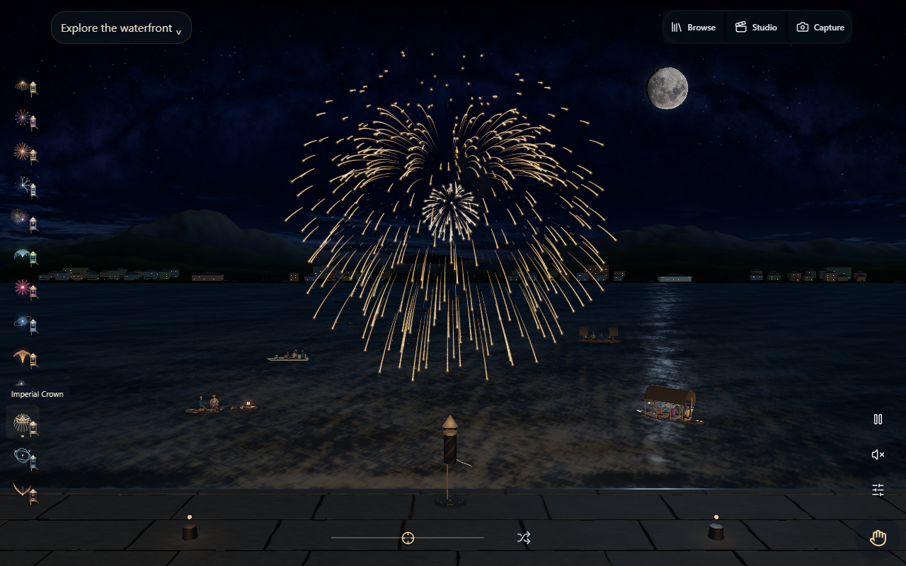

# Performance resolution — 13 October 2026

The owner required meeting the timing target before production. Runtime `77e55ac7f843c8db1e126c0801195f048fb2978e`, qualified PR head `588e7e0e89c40f3685f894d97a9ddf0f286b3060`, fixes inherited per-frame chrome CSS updates across 2,321 DOM elements. Values now update only their actual consumers. Fleet, people, detail, burst lighting, glass and particle quantities remain intact. See the parent implementation receipt and performance reports for raw measurements, the failed original target and probe corrections.

| Standard desktop Chrome comparison | Baseline p95 | Candidate p95 | Candidate CPU submission p95 |
|---|---:|---:|---:|
| WebGL first matched Super High | 4.3 ms | 4.3 ms | 7.3 ms |
| WebGL independent confirming Super High | 8.3 ms | 4.3 ms | 6.9 ms |
| WebGPU Super High | 8.3 ms | 4.3 ms | 8.3 ms |
| Idle, either backend | 4.3 ms | 4.3 ms | 5.3 / 6.7 ms |
| New boat close-up, WebGL / WebGPU | No old counterpart | 4.3 ms | 4.8 / 6.2 ms |

The previously failing Standard WebGL result was 25.0 ms. The original allowance remains the greater of 2 ms or 20%. Raw baseline variation is retained. Samples use the same PC, installed Chrome, 1280x800, seed 42, ten seconds warm and five seconds sampled per workload, with no overlapping local browser tests. Separate confirming probes verify Standard quality, unpaused state and real rendered-frame progress. These are browser rAF intervals and CPU submission, not GPU completion or physical-device timing.

[Two live launches per GPU backend](transitions-candidate.json), compared with [the original build](transitions-baseline.json), retain 4.3 ms burst-window p95 and no frames over 33 ms within those windows. One candidate WebGL 37.4 ms interval occurred outside the burst window; no repeatable new launch-transition hitch was observed in this bounded check. Canvas also completed two launches with no page errors, but lacks a paired Canvas timing baseline here. This is not endurance, Safari, physical-phone, thermal or battery qualification.

[Hosted checks](hosted.json) pass all three backends at desktop/phone viewport sizes plus installed-worker offline reload. [All 65 public files](preview-ci-bytes.json) match the exact Linux CI artifact, with release.json serving no-store. Local Windows and Linux CI output differed in six text files by line endings; the preview was refreshed from the CI artifact rather than treating normalized-source equality as exact byte equality. An initial immediate post-deploy release.json observation was transiently old; subsequent exact-byte verification passes. Preview Worker version `509925db-ab56-4fc6-b8df-a9d95fe41d45`, release `2026-10-12.1`, fingerprint `a809f42861e1d5c3fef9977ed25b478108cc480220e1ec87ad87eabe242bfd46`.

The preceding audio-capture CI attempt recovered to Canvas under software-rendering pressure, reached its automatic clip limit and timed out waiting for an unopened preview panel. One failed-job retry passed with unchanged media-decode/backend assertions; the first failure remains in run `38404697969`. No recovery policy or media assertion was weakened. Corrected full Runtime CI and exact-main release gates still control promotion/deployment; this preview receipt alone is not a production claim.

## Controlled immersion qualification

Runtime run `38404698437` passed 13 of 14 jobs. Its remaining desktop failure was the same strict opacity assertion during a 1920x1080 Ultra software-WebGL resize. [Captured diagnostics](immersion-ci-ultra-stall.json) show immersive=true, all seven ordinary controls inert, unchanged WebGL backend, no recovery, and all opacity values held at 0.939296: the compositor timeline stalled near its first transition frame while SwiftShader rasterized the enlarged Ultra scene.

The control harness now waits for the actual viewport and two presentation frames before interaction, selects Low detail explicitly only in software CI, and retains every exact opacity/inert/focus/keyboard/placement assertion and the five-second transition timeout. Native installed Chrome retains the default Ultra. [All 21 native cases](immersion-native-ultra.json) pass across WebGPU/WebGL/Canvas and seven viewport sizes; every recorded quality is Ultra. [All 14 software cases](immersion-software-low.json) pass at Low. This isolates control correctness from an unqualified software GPU stress workload; it does not claim that software Ultra transition stress passed or change application/recovery behavior. The application fingerprint remains unchanged. Corrected full CI remains required before promotion.

## CI critical-path correction

The corrected immersion step passed in run `38409397210`. Its growing desktop chain had already consumed more than twenty minutes while Always Play was still running, with endpoint/offline checks and the previously measured seven-minute original-platform flow still to execute within the unchanged 25-minute job cap. The superseded run is retained as canceled, not a full pass. Original desktop/mobile platform checks now run independently, and the four desktop control suites run in a separate job. All five moved commands, environments, the immutable engine artifact, desktop/mobile coverage, assertions and per-job 25-minute budgets are unchanged. Any shard failure still fails the required Runtime workflow. Always Play reports/captures are now retained explicitly with the controls artifact. This shortens the critical path without removing tests or increasing timeouts; no application or deployment configuration changed.
